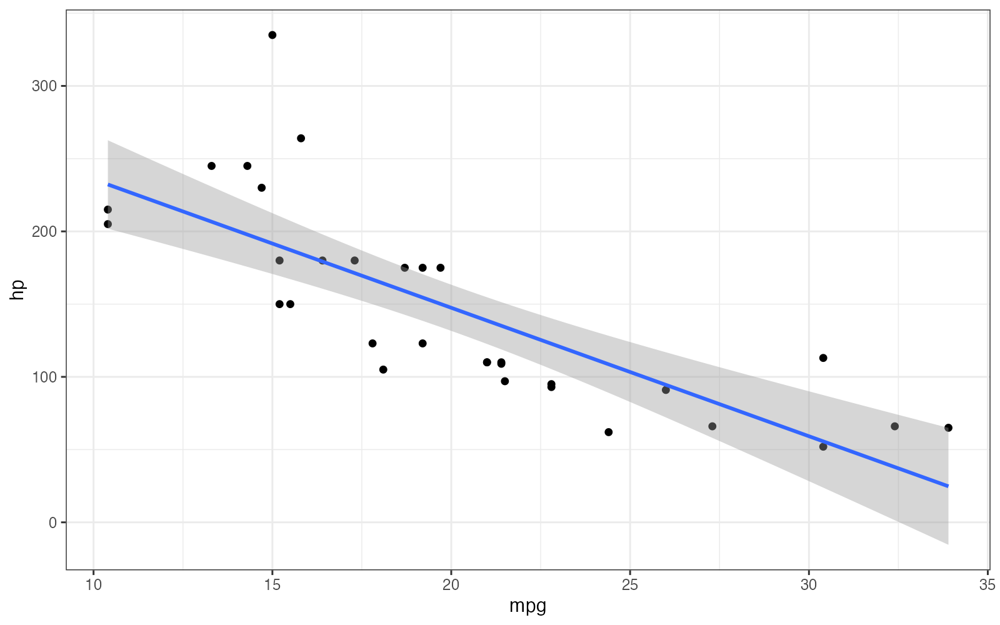
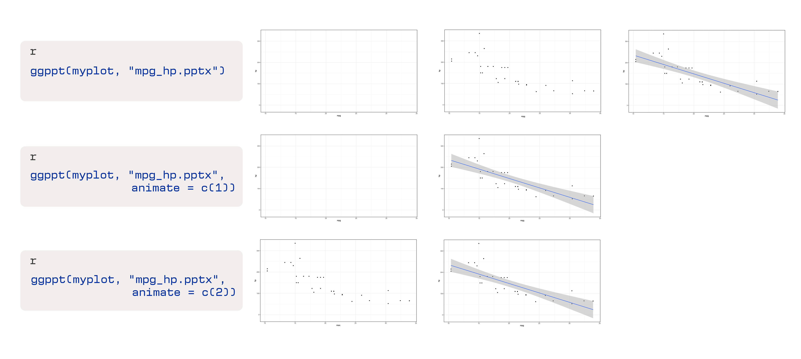

# gganimslide

`gganimslide` lets you animate the layers of your ggplots for
**PowerPoint** or **LaTeX beamer** presentations. In PowerPoint, the
layers become editable vector shapes, allowing for further customisation
after the slide has been created with
[`ggppt()`](https://joellattmann.github.io/gganimslide/reference/ggppt.md).
Native PowerPoint animations are written into the slide.
[`ggtex()`](https://joellattmann.github.io/gganimslide/reference/ggtex.md)
writes a multi-page PDF and the frame code as a `.tex` file.

### Installing `gganimslide`

``` r

# install.packages("remotes")
remotes::install_github("joellattmann/gganimslide") 
# dependencies (`ggplot2`, `officer`, `rvg`, `xml2`) are installed automatically
```

### The basics: `ggppt()` and `ggtex()`

Consider the following example using R’s `mtcars` dataset:

``` r

library(ggplot2)

myplot <- mtcars |> 
  ggplot(aes(x = mpg, y = hp)) + 
  geom_point() + # layer 1
  geom_smooth(method = "lm") + # layer 2
  theme_bw()
```

This plot has two layers,
[`geom_point()`](https://ggplot2.tidyverse.org/reference/geom_point.html)
and `geom_smooth(method = "lm")`:



For simplicity, all arguments except for the plot and the file name can
be left blank. Thus, the minimal version to turn this into an animated
PowerPoint slide looks like this:

``` r

library(gganimslide)

ggppt(myplot, "mpg_hp.pptx") # powerpoint
```

Not specifying the `animate =` argument corresponds to listing, and
consequently animating, every layer of the plot, so this is the same as:

``` r

ggppt(myplot, "mpg_hp.pptx", animate = c(1, 2))
```

All the options shown in the following figure produce exactly one slide.
The frames compare the animation steps created for each example. With
`animate = c(1)`, the animation starts at the first layer: the slide
opens with only the axes, and one click reveals both layers. With
`animate = c(2)`, the animation starts at the second layer: the slide
opens with
[`geom_point()`](https://ggplot2.tidyverse.org/reference/geom_point.html)
already present, and one click adds
[`geom_smooth()`](https://ggplot2.tidyverse.org/reference/geom_smooth.html).



The following code shows how a more elaborate animation with
[`ggppt()`](https://joellattmann.github.io/gganimslide/reference/ggppt.md)
works for a plot `p`. In `animate =`, positive numbers mark the layer at
which a step *animates in* (each step runs up to the next number);
negative numbers *animate out* the step that started at that layer.

``` r

ggppt(p, "savings.pptx",
      animate  = c(1, 2, 3, 5, 6, 8, -8),
      effect   = c("wipe_up", "wipe_left", "fade", "wipe_left", "fade", "fade", "fade"),
      trigger  = c("click", "click", "after", "click", "after", "click", "click"),
      duration = c(1, 2.5, 0.5, 2.5, 0.5, 0.6, 0.6))
```

The result is one slide. It looks like this:

The defaults for the main arguments are as follows:

- `animate =`: all layers are animated, corresponding to a vector
  enumerating all layers of the plot
- `effect =`: `"appear"`
- `trigger =`: `"click"`
- `duration =`: 0.5 seconds (`duration =` has no effect if `"appear"` is
  chosen)

To create a LaTeX beamer presentation instead, use
[`ggtex()`](https://joellattmann.github.io/gganimslide/reference/ggtex.md):

``` r

ggtex(myplot, "fig/mpg_hp.pdf", animate = c(2), tex = "mpg_hp.tex") # latex beamer
```

### Within-layer animations: `categorical = TRUE`

With `categorical = TRUE`, every **group** within a step is revealed on
its own: each bar, each box, each colour group or line from a
`colour =`/`fill =` mapping, in group order. The step’s `effect =`,
`trigger =` and `duration =` apply to each group, and a negative number
removes all groups of that step at once.

``` r

mybarplot <- mtcars |> 
  ggplot(aes(x = factor(cyl))) + 
  geom_bar() +
  theme_bw()

ggppt(mybarplot, "cyl_count.pptx", categorical = TRUE) # one bar per click
```

### Functions

| function | what it’s for |
|----|----|
| [`ggppt()`](https://joellattmann.github.io/gganimslide/reference/ggppt.md) | animated PowerPoint slide |
| [`ggtex()`](https://joellattmann.github.io/gganimslide/reference/ggtex.md) | animated beamer slide (multi-page PDF + LaTeX code) |
| [`ppt_deck()`](https://joellattmann.github.io/gganimslide/reference/ppt_deck.md) | new 16:9 deck to collect several plots with `ggppt(doc = ...)` |
| [`plot_components()`](https://joellattmann.github.io/gganimslide/reference/plot_components.md) | shows which number each part of a plot has under each `scope =` |
| [`animation_steps()`](https://joellattmann.github.io/gganimslide/reference/animation_steps.md) | previews how an `animate =` vector is split into steps, e.g., `animation_steps(6, c(3, 4, 5))` |
| [`steps()`](https://joellattmann.github.io/gganimslide/reference/steps.md) | stores the component order of a saved plot, needed for `scope = "all"` / `"all_but_theme"` |

### The `scope =` argument: what the numbers in `animate =` count

Except for teaching purposes, you may not want to reveal, i.e., animate,
anything other than the plot layers. With the default
`scope = "layers"`, only geoms, stats and
[`annotate()`](https://ggplot2.tidyverse.org/reference/annotate.html)
are counted as possible animation steps. Axes, titles, legend and theme
are always shown. Two more options let you reveal *any* `+` component:

| `scope` | numbers count |
|----|----|
| `"layers"` (default) | geoms / stats / annotations |
| `"all"` | every `+` component in the order written: geoms, [`labs()`](https://ggplot2.tidyverse.org/reference/labs.html), scales, coords, facets, `theme_*()`, [`theme()`](https://ggplot2.tidyverse.org/reference/theme.html) |
| `"all_but_theme"` | the same, but [`theme()`](https://ggplot2.tidyverse.org/reference/theme.html) / `theme_*()` are not counted and always applied |

A finished ggplot forgets the order in which its components were added,
so for `"all"` and `"all_but_theme"` the package needs that order.
Either wrap the plot code in
[`steps()`](https://joellattmann.github.io/gganimslide/reference/steps.md)
when you make the plot (the order is stored in the object and survives
[`saveRDS()`](https://rdrr.io/r/base/readRDS.html) /
[`readRDS()`](https://rdrr.io/r/base/readRDS.html)), or write the plot
code directly into the
[`ggppt()`](https://joellattmann.github.io/gganimslide/reference/ggppt.md)/[`ggtex()`](https://joellattmann.github.io/gganimslide/reference/ggtex.md)
call. The helper function
[`plot_components()`](https://joellattmann.github.io/gganimslide/reference/plot_components.md)
shows how the components are numbered under each scope.

### Slide decks

You can also build a deck with several plots:

``` r

doc <- ppt_deck() # 16:9; or ppt_deck(template = "my_template.pptx")
doc <- ggppt(p1, doc = doc, animate = c(3, 4), title = "First")
doc <- ggppt(p2, doc = doc, effect = "fade", title = "Second")

print(doc, target = "talk.pptx")
```

### Limitations

- Supports standard `ggplot2` panels (any geom,
  [`facet_wrap()`](https://ggplot2.tidyverse.org/reference/facet_wrap.html)/[`facet_grid()`](https://ggplot2.tidyverse.org/reference/facet_grid.html),
  [`coord_cartesian()`](https://ggplot2.tidyverse.org/reference/coord_cartesian.html)/[`coord_flip()`](https://ggplot2.tidyverse.org/reference/coord_flip.html)).
  Exotic extensions that change the panel structure give a clear error.
- The legend belongs to the static part, so it is visible from the
  start.

### Citation

If you use `gganimslide` in your work, please cite it:

``` r

citation("gganimslide")
```

> Lattmann, J. F. (2026). *gganimslide: Reveal ggplot2 Layers Step by
> Step in PowerPoint and Beamer Slides*. R package version 0.2.0.
> <https://github.com/joellattmann/gganimslide>
